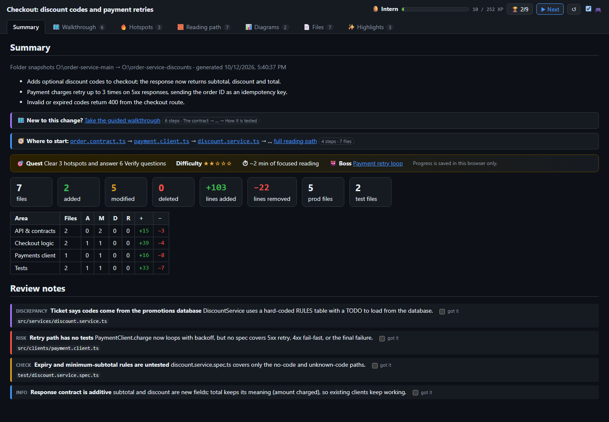
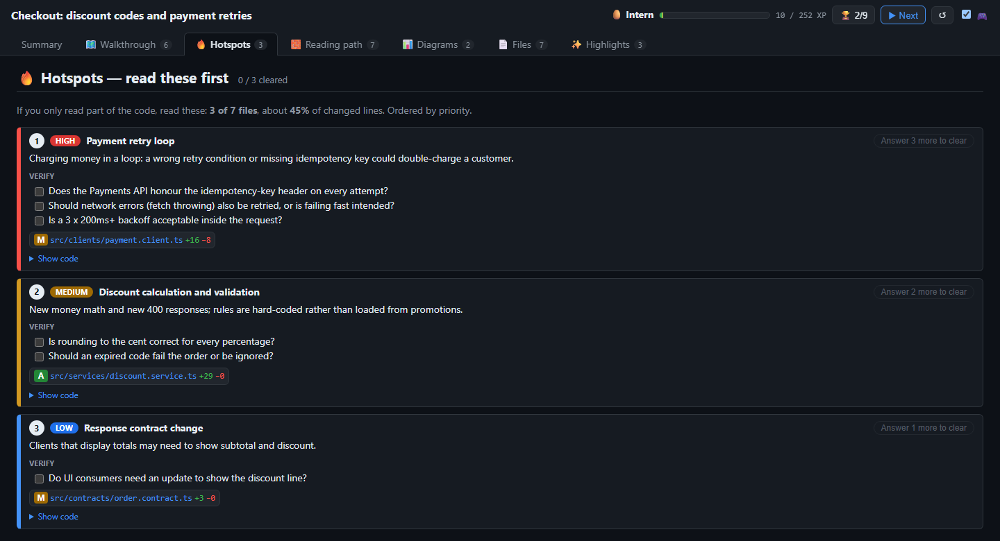
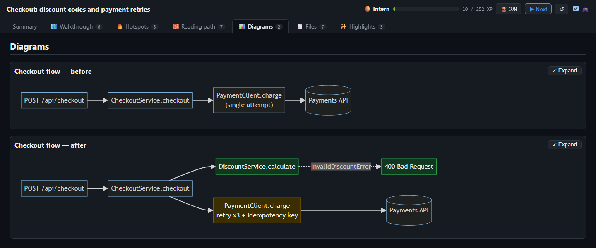
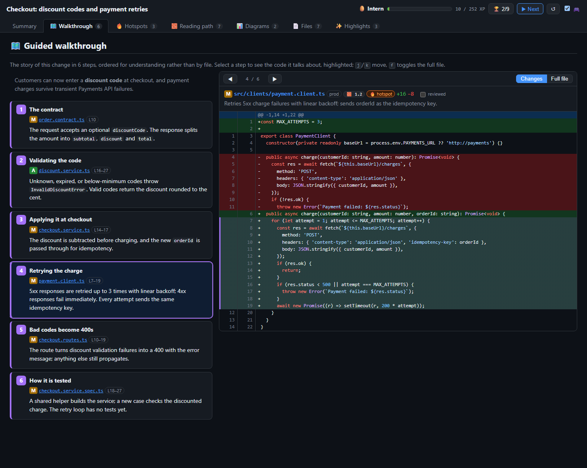

# review-brief-plugin

A GitHub Copilot CLI plugin that adds the **review-brief** skill. Ask Copilot for a brief of a set of code
changes and it builds a temporary, standalone HTML page that helps you understand the change before you
review it.

The brief includes:

- **Summary**: stats, a "where to start" pointer, and review notes, including discrepancies between the
  change and its stated purpose.
- **Hotspots**: the riskiest areas to read first, each with items to verify.
- **Reading path** and an optional **guided walkthrough**: a suggested order for reading the change.
- **Diagrams**: before/after Mermaid diagrams of the affected flow.
- **Files**: a one-line description of each changed file, with the diff or full file shown alongside.
- **Highlights**: the key code snippets.
- An optional **review quest** game layer that tracks your review progress in the browser.

It works with Angular/SKY UX SPAs, .NET services, and any project git can diff. Supported sources:

- Uncommitted local changes
- A branch or commit range
- A GitHub pull request
- An Azure DevOps pull request
- A patch file
- Two folder snapshots

The brief is a reading aid. It does not replace code review.

## Screenshots

These come from a brief for a small sample change that adds discount codes and payment retries to a
fictional checkout service.

**Summary**: what changed, where to start, per-area stats, and review notes (including a discrepancy
between the ticket and the code).



**Hotspots**: the code to read first, ranked by risk, with questions to answer before approving.



**Diagrams**: before/after flow diagrams, with new components in green and changed ones in yellow.



**Guided walkthrough**: the change told as ordered steps. Selecting a step opens the file with the relevant
lines highlighted.



## Requirements

- [GitHub Copilot CLI](https://docs.github.com/copilot/how-tos/copilot-cli)
- Node.js 18 or later
- For GitHub PRs: the [GitHub CLI](https://cli.github.com/) (`gh`), authenticated
- For Azure DevOps PRs: the [Azure CLI](https://learn.microsoft.com/cli/azure/) (`az`) with the
  `azure-devops` extension, logged in

## Install

```shell
copilot plugin install blackbaud-BrandonPasquarelli/review-brief-plugin
```

Check that the plugin is installed:

```shell
copilot plugin list
```

In a new Copilot session, `/skills list` should include `review-brief`.

## Usage

Ask Copilot in plain language. For example:

- "Give me a review brief of my uncommitted changes."
- "Create a review brief for this branch compared with origin/main."
- "Review brief for https://github.com/owner/repo/pull/123"
- "Summarize Azure DevOps PR https://dev.azure.com/org/project/_git/repo/pullrequest/456 visually before I
  review it."

The page is written under `%TEMP%\change-viz\` (outside any repo), and Copilot gives you its path. The skill
doesn't modify your repositories. Your code is not sent to third-party services; the page only loads the
Mermaid script from a CDN to draw diagrams.

## Update or uninstall

```shell
copilot plugin update review-brief
copilot plugin uninstall review-brief
```

## Local development

Install from a local clone to test changes:

```shell
copilot plugin install ./review-brief-plugin
```

The CLI caches installed plugins, so run the install command again after each edit. The skill lives in
`skills/review-brief/`; its generator is `scripts/change-viz.js` (run `node change-viz.js --help` for the
options).
